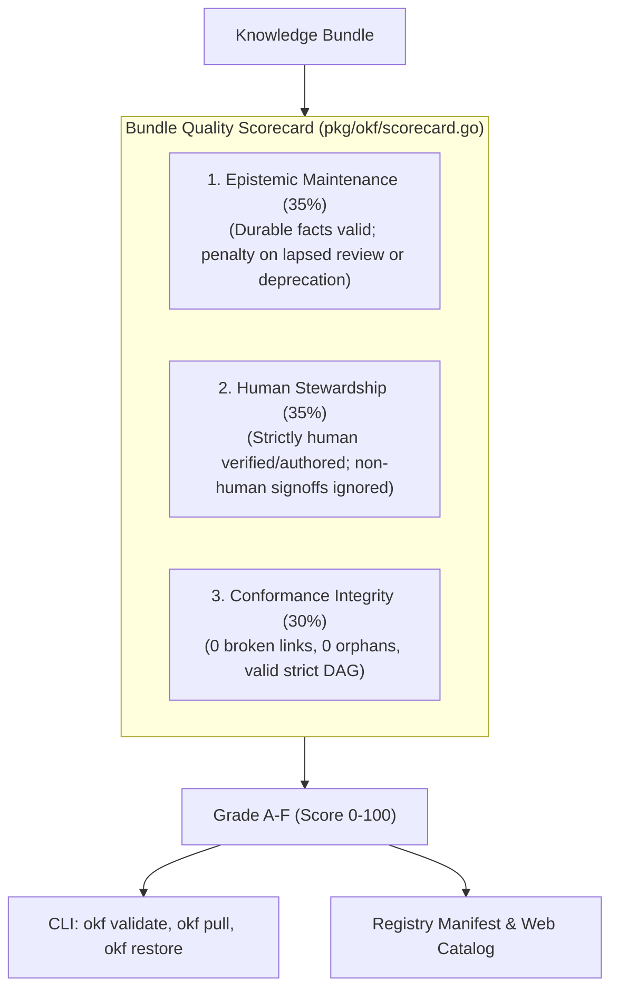

# Decision: Bundle Quality Scorecards and Pre-Pull Verification

## Context & Motivation

Cryptographic SHA-256 integrity hashes in `okf.lock` guarantee byte-for-byte immutability, but do not guarantee veracity, freshness, or human oversight. Without quality signals prior to installation, unmaintained or hallucinated bundles can become "reproducibly wrong" across agent repositories.

However, knowledge bundles differ fundamentally from transient code libraries: version-scoped facts (e.g. Next.js 15 caching defaults or Tailwind v4 tokens) remain true indefinitely. Forcing arbitrary `stale_after` calendar deadlines on immutable domain facts creates "maintenance theater" (meaningless date bumping to keep a scorecard green).

## Decision: 3-Pillar Bundle Scorecard

The quality scorecard evaluates any OKF bundle across three weighted dimensions:

### 1. Epistemic Maintenance & Relevance (35%)
* **Durable Invariants by Default:** Concepts of any type without an explicit `stale_after` review deadline are treated as 100% valid by default, preventing artificial maintenance chores.
* **Targeted Lapsed Penalty:** Concepts that opt into `stale_after` (e.g. temporary runbooks, workarounds) and exceed their deadline receive 0 points.
* **Lifecycle Status:** Active `stable` status earns 100%, `draft` earns 70%, and `deprecated` earns 0%. A deprecated root bundle index zeroes out the bundle's maintenance score.

### 2. Human Stewardship & Provenance (35%)
* **Human Verification Invariant:** In accordance with the project codex, `verified:` is strictly reserved for human identities (`human/*` or `user/*`). Non-human verifications (`agent/*`, `tool/*`) do not grant stewardship points.
* **Scoring:**
  * Verified by human or authored by human: 100 points
  * Unreviewed synthetic agent concepts (`generated.by: agent/*`): 20 points
  * Unattributed concepts: 0 points

### 3. Graph & Conformance Integrity (30%)
* Evaluated via strict OKF v0.2 validation starting at 100 base points.
* Deductions: validation errors (-25 pts), broken concept links (-15 pts), orphan nodes (-10 pts), gate findings (-10 pts), warnings (-5 pts). Clamped to [0, 100].

### Grade Scale
* **Grade A:** Score 90–100 (production-grade, human-verified, conformant)
* **Grade B:** Score 80–89 (high quality, minor gaps)
* **Grade C:** Score 70–79 (usable, unreviewed synthetic or draft content)
* **Grade D:** Score 60–69 (warning, lapsed deadlines or broken links)
* **Grade F:** Score < 60 (failed, deprecated, or structurally broken)

## SSoT & Unified CLI Architecture
The scorecard evaluation engine lives canonically in `pkg/okf/scorecard.go`, exposed through `okf validate`, `okf pull`, and `okf restore` without redundant top-level commands:
* `okf validate [bundle] --scorecard [--json]`
* `okf validate [bundle] --min-score <N> [--json]`
* `okf pull <bundle> --min-score <N>` (aborts and rolls back vendor installation if below threshold)
* `okf restore --min-score <N>` (aborts restoration if any locked bundle is below threshold)
The registry catalog generator and client-side CLI gating share this identical deterministic engine.

# Related Concepts
- [5-Layer System Architecture](layers.md): Tooling layer governs deterministic bundle verification
- [OKF Registry Client, Dependency Locking, and Multi-Scope Vendor Layering](registry-and-vendor-layering.md): Pre-pull quality signals for vendor bundles
